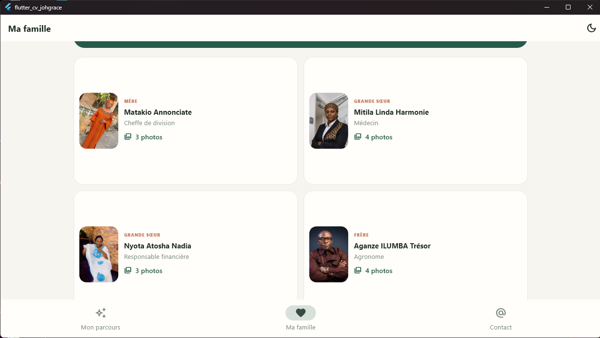
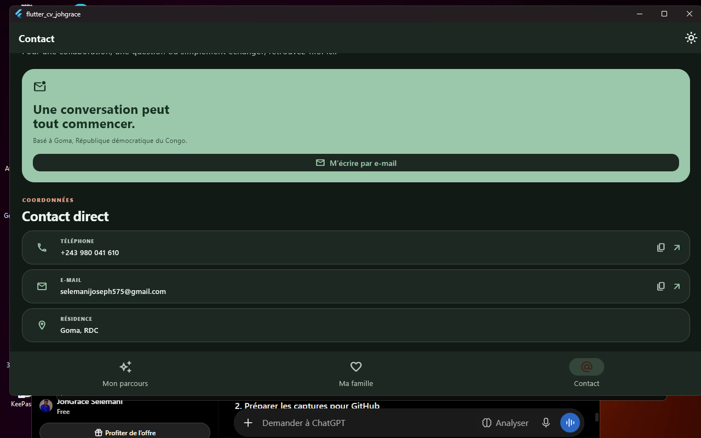

# CV Flutter - JohGrâce Selemani

## Présentation

Application de portfolio personnel réalisée en Dart avec Flutter. Elle présente
le parcours, les compétences, les formations, les réalisations, le ministère,
les centres d’intérêt, la famille et les coordonnées de JohGrâce Selemani.

L’application propose un écran de connexion, un portfolio responsive, la
consultation et la gestion des membres de la famille via une API REST, ainsi
que des galeries de photos et de documents locaux. Elle n’expose pas de gestion
des comptes.

## Fonctionnalités

- Portfolio en huit sections, adapté aux différentes largeurs d’écran.
- Connexion vérifiée par l’API REST.
- Gestion des membres de la famille : consultation, ajout, modification,
  suppression et actualisation.
- Import guidé des anciens membres, avec validation des informations et
  vérification des doublons détectables avant l’envoi.
- Envoi facultatif de la photo principale d’un membre, limité à 2 Mo.
- Galerie de huit vidéos YouTube avec miniatures issues des photos locales.
- Galeries de photos, certificats et distinctions, avec affichage plein écran
  et zoom des documents.
- Page de contact, liens sociaux et thèmes clair et sombre.

## Technologies et architecture

- Dart et Flutter, avec Material Design.
- API REST PHP et base de données MySQL pour les opérations de famille.
- `http` pour les appels réseau, `font_awesome_flutter` pour les icônes et
  `url_launcher` pour les liens externes.

Organisation du code :

- `lib/core/` : thème et réglages visuels.
- `lib/data/` : modèles, données locales et accès à l’API.
- `lib/pages/` : connexion, portfolio, famille et contact.
- `lib/widgets/` : composants réutilisables.
- `assets/images/` : portraits, photos familiales, documents et logo.
- `test/` : tests unitaires et tests de widgets.

## Installation

Prérequis : Flutter SDK et une API REST compatible, connectée à sa base de
données MySQL.

```bash
git clone https://github.com/Iamjohgrace0208/cv_flutter_johgrace.git
cd cv_flutter_johgrace
flutter pub get
```

Lancer l’application avec l’adresse de l’API :

```bash
flutter run --dart-define=API_BASE_URL=http://localhost/api-test/public
```

L’URL configurée doit inclure le segment `/public`. Sans configuration,
l’application utilise `http://localhost/api-test/public`, ou
`http://10.0.2.2/api-test/public` sur l’émulateur Android. Pour Flutter Web,
l’API doit autoriser les requêtes CORS.

## Contrat et limite de sécurité de l’API

La connexion utilise `POST /accounts/login`. La gestion familiale utilise les
routes suivantes :

- `GET /famille-membres` : consultation.
- `POST /famille-membres` : création.
- `PUT /famille-membres/{id}` : modification.
- `DELETE /famille-membres/{id}` : suppression.

Le client n’envoie pas de jeton ou d’identifiant de session avec ces requêtes.
La connexion dans l’application ne garantit donc pas que les données familiales
soient protégées : cette protection dépend du contrôle d’accès effectivement
implémenté par l’API. Vérifier et sécuriser ces routes côté serveur avant toute
utilisation de données réelles ou mise en production.

## Démonstration

[Voir la vidéo de démonstration](docs/demonstration.mp4).

## Captures d’écran

### Connexion


### Portfolio


### Gestion de la famille



### Contact



## Médias et attribution

Les documents de `assets/images/certifications/` sont présentés tels qu’ils ont
été fournis. Le logo de l’ISIG-GOMA est conservé dans
`assets/images/isig/logo_isig.jpg`.

Attribution du logo : ISIG-GOMA, téléversé sur Wikimedia Commons par Bigega,
[licence Creative Commons Attribution-ShareAlike 4.0](https://creativecommons.org/licenses/by-sa/4.0/),
[fiche du fichier](https://commons.wikimedia.org/wiki/File:Logo_isig.jpg).

## Auteur

**JohGrâce Selemani**

- [GitHub](https://github.com/Iamjohgrace0208)
- [LinkedIn](https://www.linkedin.com/in/joseph-grace-selemani/)
- [YouTube](https://youtube.com/@iamjohgrace)
- [TikTok](https://www.tiktok.com/@iamjohgrace)
