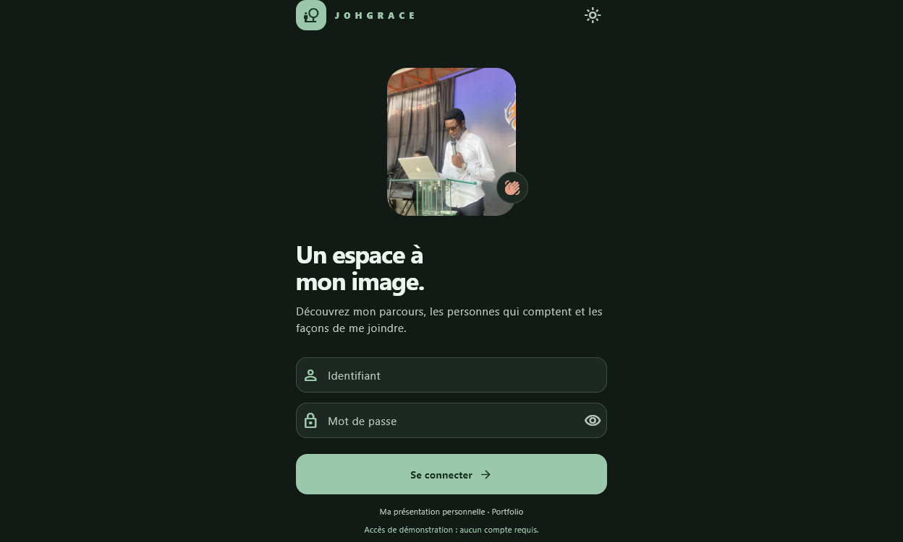
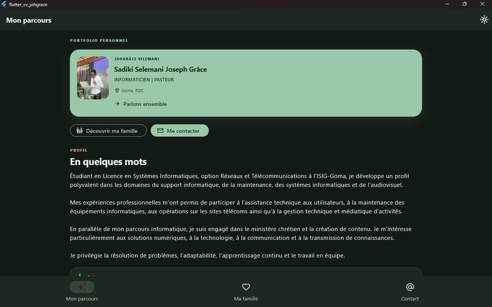

# CV Flutter - JohGrâce Selemani

## Présentation du projet

**CV Flutter** est une application Flutter qui présente mon curriculum vitae, ma famille et mes coordonnées. L’application utilise l’API REST [api-test](https://github.com/espoirbaraka/api-test) pour vérifier les identifiants et gérer les membres de la famille. L’API ne demande toutefois aucune authentification sur ses endpoints de famille : la connexion dans l’application ne constitue pas un contrôle d’accès côté API.

La connexion vérifie les identifiants auprès de l’API. Un nouvel utilisateur peut créer son compte depuis l’écran de connexion. Une fois connecté, l’utilisateur peut consulter, ajouter, modifier et supprimer les membres de la famille. Les données de ces opérations sont enregistrées par l’API dans sa base de données MySQL.

## Fonctionnalités

L’application comprend les sections suivantes :

- **Connexion :** authentification réelle via `POST /accounts/login`, avec création de compte via `POST /accounts/register`.
- **Portfolio :** parcours éditorial en huit sections, portraits locaux, formation à l’ISIG-GOMA, galerie des documents et liens de contact.
- **Famille :** consultation, ajout, modification et suppression des membres via les endpoints REST `/famille-membres`. Les créations et modifications transmettent les champs requis par l’API.
- **Import des anciens membres :** chaque personne de `profile_data.dart` est proposée individuellement. Les noms, la date et le lieu de naissance sont saisis et confirmés manuellement ; l’application vérifie la liste de l’API avant la création. La photo principale peut être envoyée (2 Mo maximum), tandis que les albums et professions restent conservés dans le portfolio local.
- **Contact :** présentation de mes coordonnées et de mes réseaux sociaux.

Les requêtes affichent les erreurs renvoyées par le serveur. La liste de famille peut être actualisée par balayage ou avec le bouton d’actualisation.

## Portfolio et médias locaux

Les portraits et photographies familiales sont intégrés depuis `assets/images/`. Les documents fournis sont copiés sans modification dans `assets/images/certifications/` et présentés dans une galerie responsive, avec ouverture plein écran et zoom. Le logo de l’ISIG-GOMA est embarqué localement dans `assets/images/isig/logo_isig.jpg` afin que son affichage ne dépende pas d’Internet.

Attribution du logo : ISIG-GOMA, téléversé sur Wikimedia Commons par Bigega, [licence Creative Commons Attribution-ShareAlike 4.0](https://creativecommons.org/licenses/by-sa/4.0/), [source et historique du fichier](https://commons.wikimedia.org/wiki/File:Logo_isig.jpg). Le logo est utilisé sans modification.

## Configuration de l’API

L’API et sa base MySQL doivent être démarrées avant l’application. Suivez les instructions du [README de l’API](https://github.com/espoirbaraka/api-test) : création de la base `api`, import de `api.sql` et configuration de `.env`. L’API doit être servie sous `/public`.

Le segment `/public` est obligatoire. Sans `API_BASE_URL`, l’application utilise `http://10.0.2.2/api-test/public` sur l’émulateur Android et `http://localhost/api-test/public` sur les autres plateformes (développement local). Sur iOS, configurez une URL HTTPS accessible à l’appareil, conformément à la politique ATS. Pour changer l’adresse, passez `API_BASE_URL` au lancement :

```bash
# Linux ou application de bureau, API locale
flutter run --dart-define=API_BASE_URL=http://localhost/api-test/public

# Émulateur Android, API hébergée sur l’ordinateur
flutter run --dart-define=API_BASE_URL=http://10.0.2.2/api-test/public
```

Sur un appareil Android physique, utilisez l’adresse IP de l’ordinateur accessible depuis le téléphone, par exemple `flutter run --dart-define=API_BASE_URL=http://192.168.1.10/api-test/public` pour le développement local (HTTP est autorisé par la configuration Android de ce projet). Sur iOS, `localhost` désigne l’appareil lui-même et la politique ATS par défaut exige HTTPS : utilisez une API accessible en HTTPS. Pour Flutter Web, le serveur doit autoriser les requêtes CORS depuis l’origine de l’application. L’API fournie n’exige aucun jeton pour ses endpoints de famille : la connexion vérifie un compte, mais ces routes restent appelables directement. Utilisez HTTPS en production.

Les appels de création, modification et suppression sont envoyés à l’API ; l’application ne conserve pas ces membres uniquement en local. Pour que les changements persistent, configurez et démarrez MySQL conformément au README de l’API et importez `api.sql`. Vérifiez le déploiement en créant un membre puis en actualisant la liste ou en redémarrant l’application.

### Tester l’import des anciens membres

1. Démarrez l’API et MySQL, connectez-vous, puis ouvrez **Ma famille**.
2. Dans **Anciens membres du portfolio**, choisissez **Importer** sur une seule personne.
3. Vérifiez la source affichée, puis saisissez le nom, le postnom, le prénom, la date (`AAAA-MM-JJ`) et le lieu de naissance. Ces champs ne sont volontairement pas devinés. Le lien de parenté est proposé depuis la fiche locale et reste modifiable.
4. Laissez **Envoyer la photo principale** activé pour envoyer la première photo de l’album, ou désactivez-le. Une image supérieure à 2 Mo est refusée par le client ; l’import peut être relancé sans image. Les autres photos restent dans la galerie locale.
5. Appuyez sur **Confirmer l’importation**. Des champs vides ou invalides bloquent l’envoi. Juste avant la création, l’application recharge les membres de l’API et bloque un nom déjà présent.
6. Vérifiez l’apparition du membre dans la liste API, puis actualisez ou relancez l’application. La fiche locale et sa profession demeurent dans **Anciens membres du portfolio** ; la profession n’est pas envoyée, car le contrat API ne la prend pas en charge.

L’API documente une liste GET et un téléversement multipart, mais pas de contrainte d’unicité sur les personnes. Le contrôle client évite les doublons détectables au moment de l’import, sans garantir l’unicité si plusieurs appareils créent simultanément le même membre. Aucun changement de schéma MySQL ou de contrôleur PHP n’est requis pour cet import.

## Captures d'écran

### 1. Page de connexion



### 2. Page d'accueil - CV



### 3. Page famille


### 4. Page contact


## Vidéo de démonstration

La vidéo de démonstration n’est pas encore jointe. Téléversez le fichier vidéo dans les pièces jointes GitHub du dépôt, puis insérez ici l’URL générée par GitHub.

La vidéo doit montrer la connexion, la consultation de la famille et les opérations d’ajout, de modification et de suppression.

## Technologies utilisées

- Flutter
- Dart
- Material Design
- API REST PHP et base de données MySQL
- Git
- GitHub

## Installation et exécution

Cloner le dépôt :

```bash
git clone https://github.com/Iamjohgrace0208/cv_flutter_johgrace.git
```

Accéder au dossier :

```bash
cd cv_flutter_johgrace
```

Installer les dépendances :

```bash
flutter pub get
```

Lancer l'application :

```bash
flutter run --dart-define=API_BASE_URL=http://10.0.2.2/api-test/public
```

Créez un compte depuis l’écran de connexion ou utilisez un compte déjà enregistré dans l’API. Pour Linux ou le Web, remplacez `10.0.2.2` par l’adresse à laquelle le serveur API est accessible.

### Transfert et exécution sous Windows

Le dossier `windows/` contient déjà la cible de bureau Flutter. Pour produire
l’application Windows, transférez ou clonez le dépôt sur un ordinateur Windows
avec Flutter installé et Visual Studio configuré avec la charge de travail
**Développement Desktop en C++**. Vérifiez l’installation avec
`flutter doctor -v`, puis ouvrez PowerShell dans le dossier du projet :

```powershell
flutter pub get
flutter run -d windows --dart-define=API_BASE_URL=http://localhost/api-test/public
```

Pour générer la version de production :

```powershell
flutter build windows --release --dart-define=API_BASE_URL=http://localhost/api-test/public
```

L’API doit être démarrée et accessible depuis Windows. Remplacez `localhost`
par son adresse si elle se trouve sur une autre machine. Le binaire Windows
doit être compilé sur Windows ; transférez le code source et les médias du
dépôt, pas le dossier `build/` généré sous Ubuntu.

## Auteur

**JohGrâce Selemani**

- GitHub : https://github.com/Iamjohgrace0208
- LinkedIn : https://www.linkedin.com/in/joseph-grace-selemani/
- YouTube : https://youtube.com/@iamjohgrace
- TikTok : https://www.tiktok.com/@iamjohgrace

---

Projet réalisé dans le cadre d'un travail pratique de développement mobile avec Flutter.